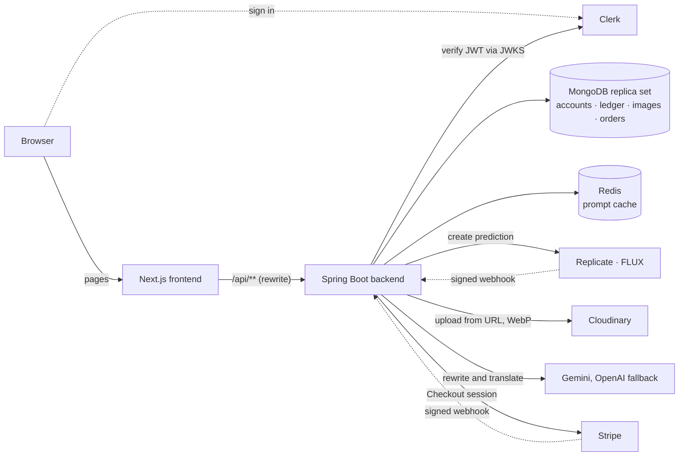

# Sketchfast — AI Image Generation SaaS

Pay-per-use AI image generation. Users describe a picture in any language, pick one of eight comic styles, and get the image in about ten seconds. Each image costs one credit; new users get 20, and more are bought through Stripe Checkout.

The hard part is the money. The platform pays the model provider for every call, calls fail or time out, and payment callbacks arrive more than once. The backend makes sure a user is never charged twice, never left without a refund, and never credited twice for one payment.


> This repository is a Next.js frontend with a Spring Boot backend. The original full-stack Next.js (TypeScript) version is in [sketchfast-nextjs](https://github.com/KeitouYa/sketchfast-nextjs).

## Architecture



The frontend only talks to the REST API, so the backend can be swapped. The backend is one Spring Boot module, packaged by feature (`credit`, `payment`, `image`, `prompt`, `security`, `common`). Errors are RFC 9457 problem details with a stable `code` and the `requestId`.

## How the money stays correct

- **A ledger, not just a balance.** Every change writes a ledger entry with a unique key (`signup:{email}`, `image:{id}:charge`, `image:{id}:refund`, `payment:{orderId}`) in the same MongoDB transaction as the balance update. A retried request hits the unique index and changes nothing, and the balance always equals the sum of the ledger.
- **No overdraft.** Charging is one conditional update: it only succeeds while `balance >= cost`.
- **Refund exactly once.** An image moves `PENDING → SAVING → SUCCEEDED | FAILED`, each step a conditional update. Failing the image and refunding happen in one transaction, so however many paths race to finish a job, it is refunded once.
- **What counts as a failure.** Only an image that was never delivered: the model errored, nothing came back within 5 minutes, storage failed, or the model's safety filter rejected it (reported as `CONTENT_FILTERED`, so the user knows to reword). Running jobs are never canceled, because the provider bills them anyway.
- **Three ways a result arrives.** Replicate's signed webhook (Standard Webhooks HMAC), a scheduled poller, and a timeout sweep. While the owner is waiting on the page, reading the image's status also checks Replicate, at most once every 2 seconds per image.
- **Stripe credits an order once.** Prices come from the server's package list; the client sends only a package id. The webhook (signature checked, deduplicated by event id) and the return page both call the same fulfillment step, which checks the amount paid and moves the order `PENDING → PAID` with a conditional update.
- **Same-account transactions are queued.** MongoDB transactions are optimistic: two that write the same document abort each other instead of waiting. Load testing showed 45% of requests failing at 20 concurrent requests per user. Balance changes now take a per-account lock (256 lock stripes) around a retried transaction, which brought failures and retries to zero. Across several servers, the retry on transient transaction errors is still the backstop.

## Load test results

Local Docker (MongoDB 7, single-node replica set via Testcontainers), JDK 21, 16 cores. Replicate, Cloudinary and Stripe are simulated, with injected failures.

| Scenario | Result |
|---|---|
| 1,000 orders, each confirmed 5 times at once | Each order credited exactly once. p99 3.9 s, 0 transaction retries (the Node.js version: p99 77.6 s) |
| 10,000 concurrent charges against a balance of 1,000 | Exactly 1,000 succeed; the balance ends at 0 |
| 1,000 new users, 5 concurrent first requests each | Every user ends with exactly 20 free credits. p99 2.6 s |
| 2,000 users generate at once, about 7% injected failures | 136 failures, each refunded exactly once; each success stored once. Submit p99 1.8 s |
| 10,000 concurrent charges on one account | All correct but serialized: p99 66 s. This is the price of keeping the ledger and balance in one transaction; real users don't do this |

## Tech stack

| | |
|---|---|
| Backend | Java 21, Spring Boot 4.1 (Web MVC, Security OAuth2 resource server, Data MongoDB, Data Redis, Cache), Spring AI 2.0, Resilience4j |
| Frontend | Next.js 15 (App Router), React 19, TypeScript, Tailwind CSS 4, shadcn/ui |
| Data | MongoDB replica set (multi-document transactions), Redis |
| Services | Clerk (auth), Stripe Checkout, Replicate (FLUX schnell), Cloudinary, Gemini and OpenAI |
| Testing | JUnit 5, Testcontainers, MockRestServiceServer, Jest |

## Run locally

You need JDK 21, Node 20+ and Docker.

```bash
docker compose up -d                  # MongoDB replica set on 27017, Redis on 6380

cd backend-java
cp .env.example .env                  # fill in the keys; each one is explained in the file
./mvnw spring-boot:run                # http://localhost:8080

cd ../frontend
cp .env.example .env.local            # API_URL and the Clerk keys
npm install --legacy-peer-deps
npm run dev                           # http://localhost:3000
```

**Clerk:** the backend needs the user's email and name in the session token. In the Clerk dashboard, open Sessions → Customize session token and add:

```json
{ "email": "{{user.primary_email_address}}", "name": "{{user.full_name}}" }
```

**Stripe:** put a test key (`sk_test_...`) in `STRIPE_SECRET_KEY` and pay with card `4242 4242 4242 4242`. Webhooks are optional locally, because the success page confirms the payment too. To test them, run `stripe listen --forward-to localhost:8080/api/webhooks/stripe` and put the printed secret in `STRIPE_WEBHOOK_SECRET`.

## Tests

```bash
cd backend-java
./mvnw test                                          # 82 unit and integration tests; Docker is needed for Testcontainers
./mvnw test -Dgroups=load -Dtest.excluded.groups=    # the load scenarios above, written to target/loadtest-results.json
./mvnw test -Dgroups=live -Dtest.excluded.groups=    # calls the real Replicate, Cloudinary and Gemini (costs a few cents)

cd ../frontend
npm test
```

## API

| Method | Path | Who | What |
|---|---|---|---|
| GET | `/api/styles` | anyone | Style presets |
| GET | `/api/credit-packages` | anyone | Credit packages and prices |
| GET | `/api/me/credits` | signed in | Balance |
| GET | `/api/me/credit-ledger` | signed in | Ledger entries, newest first |
| POST | `/api/images` | signed in | Submit a prompt; charges 1 credit and returns `202` with the image id |
| GET | `/api/images/{id}` | anyone with the link | Status and, when done, the image URL |
| GET | `/api/me/images` | signed in | Gallery |
| POST | `/api/prompts/enhance` | signed in | Expand a few words into a detailed prompt |
| POST | `/api/payments/checkout` | signed in | Create a Stripe Checkout session for a package |
| POST | `/api/payments/{orderId}/confirm` | signed in | Return-page confirmation |
| POST | `/api/webhooks/replicate`, `/api/webhooks/stripe` | provider | Signed webhooks |

## Repository layout

```
backend-java/   Spring Boot backend (credits, ledger, Stripe, image jobs, prompts)
frontend/       Next.js pages; they reach the backend only through /api/**
docker-compose.yml   MongoDB replica set and Redis for local development
```
